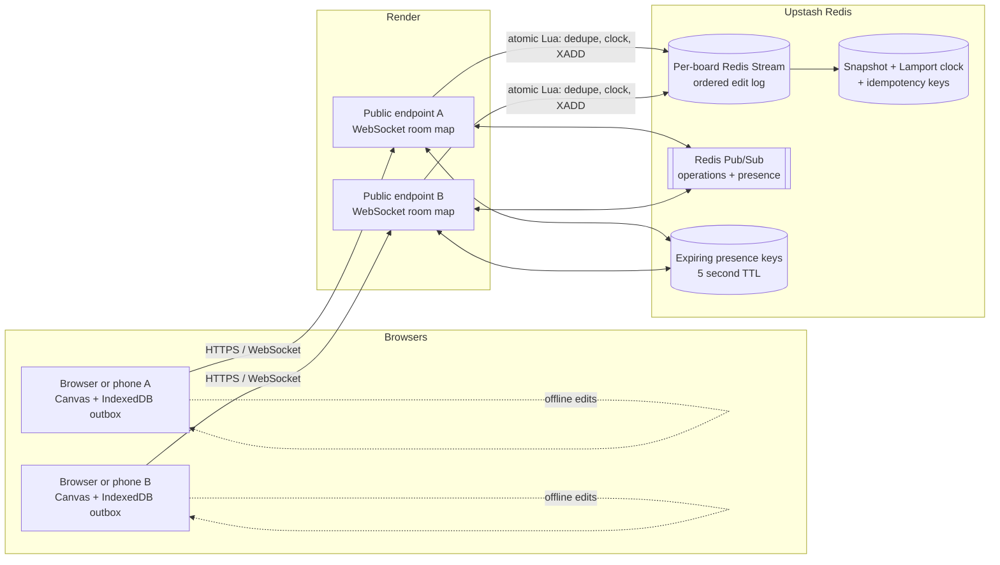

# SyncBoard architecture

## Public judging topology

After the second Render service is approved, the demo uses two public HTTPS endpoints. Each endpoint runs one stateless Node process; both point at the same Upstash Redis store. Render free services cannot be scaled behind one load balancer, so judges should open both endpoints during the cross-instance demo.

## Edit path

1. The browser applies an edit immediately and stores its operation in the IndexedDB outbox.
2. The browser sends the operation over WebSocket to the endpoint it opened.
3. The app validates the payload and sends one Redis Lua script. The script rejects duplicates and over-limit actors, chooses a Lamport value greater than both the stored board clock and the client's optimistic clock, appends the event to the board stream, then publishes it.
4. Every app process receives the Pub/Sub event and forwards it to its own WebSocket clients. The originating browser removes the outbox entry when it receives its authoritative event.
5. A reconnect sends the last stream cursor. The app returns the snapshot and the later stream tail; retrying the same operation ID is safe for seven days.

Each shape field is merged as a last-writer-wins register ordered by the server Lamport value and actor ID. Different fields can merge independently. Concurrent writes to the same field resolve deterministically by the order Redis accepts them. Undo is a new compensating edit in the current browser's own history.

## Board load and recovery

The stress board is a separate, fixed `stress-demo` room with 5,000 generated shapes. Generation is create-once: it cannot replace the `studio` board or erase edits already made in the stress room. The browser indexes objects into 512-pixel spatial cells for viewport painting and hit testing, and updates its minimap bounds as objects change.

After 800 operations, an app process takes a board compaction lock, re-reads the current snapshot and stream tail, writes a newer snapshot, then trims events covered by that snapshot. Reconnecting clients behind the snapshot cursor receive the newer snapshot.

If Redis is unavailable, app commands fail promptly and the WebSocket closes. The browser keeps local edits in IndexedDB, reconnects with capped backoff, and replays its outbox when the shared store returns. If an app process stops, its browser sockets close; the second public endpoint continues to serve the shared Redis-backed board. The two free endpoints are separate URLs, so a browser connected to a stopped endpoint needs that endpoint to return or the judge must open the other URL.

Presence is stored per tab with a five-second Redis TTL. The browser refreshes it on cursor motion at most ten times per second and sends a heartbeat every 2.5 seconds. The browser also removes stale presence locally after four seconds without an update.

## Data store decision

Redis is the shared database for the prototype: snapshots are materialized board state and Redis Streams are the operation log. There is no separate SQL database or second write path. Pub/Sub is a delivery channel only; a missed live event is recovered from the stream on reconnect. Durability and recovery after Redis itself loses data depend on the configured Redis provider and its persistence policy.

The live panel reports Redis event relay p95, which measures app-to-app Pub/Sub relay delay. It is not a measurement of end-to-end browser-to-browser visible latency. Use the 200-client demo tool for a same-runner peer receive p95, and use real judge devices to evaluate their full network path.

